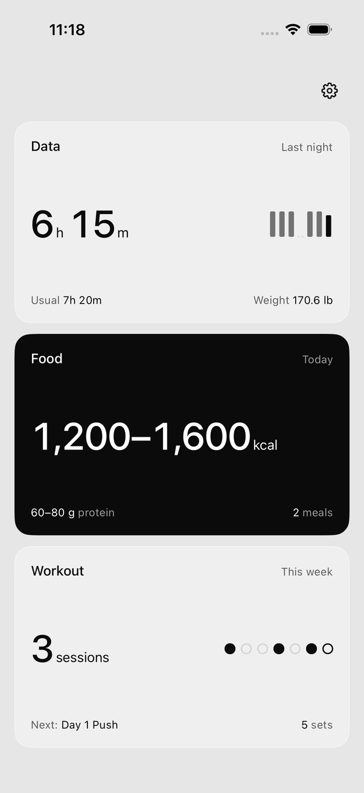
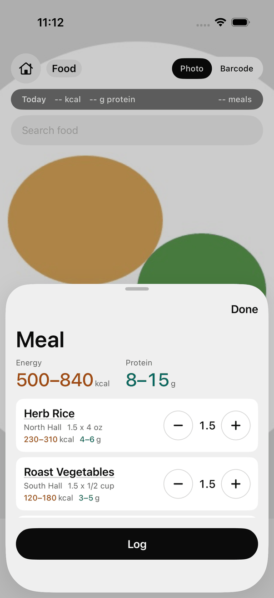
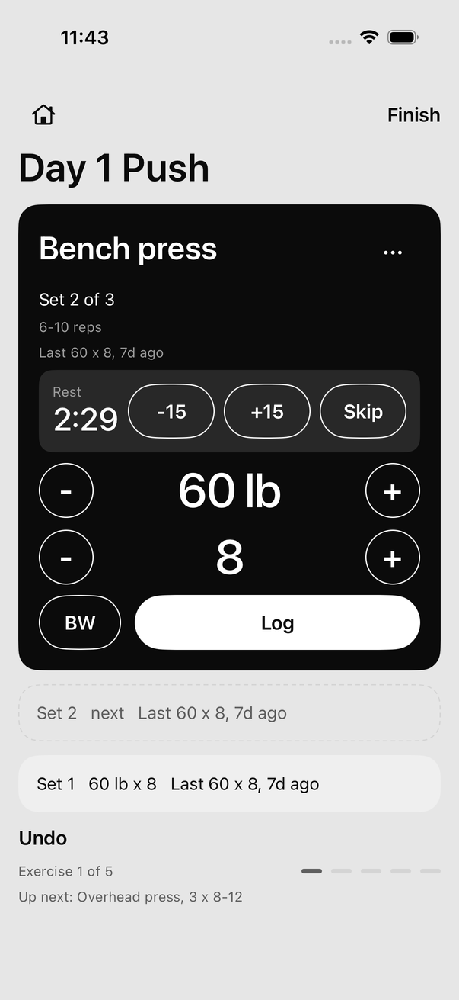
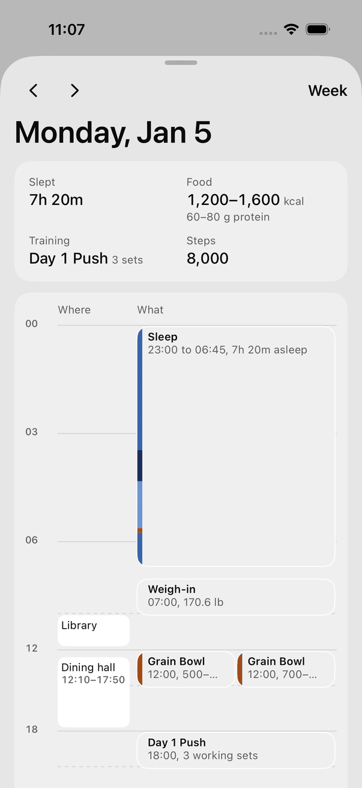
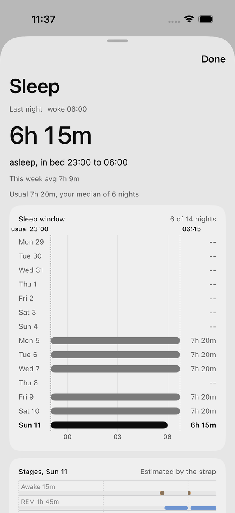
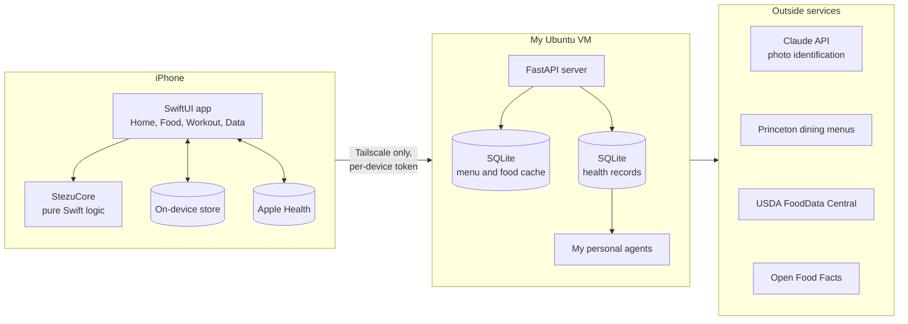

# Ingest

An iPhone app for the health data you have to enter by hand: meals from a photo, gym sets and weigh-ins, shown next to the sleep, HRV and step data Apple Health already has.

  
  
  
  
  

Screens exported by the iOS UI tests, which run on made-up data. No real health data is in this repo (<a href="DECISIONS.md">D-034</a>).

## What it is and why

A wearable already records my sleep, heart rate and HRV into Apple Health without any effort from me. What I eat, what I lift and what I weigh have to be entered by hand, and that is the part I kept skipping. Ingest is built around one rule from [SPEC.md](SPEC.md): logging must cost fewer taps than skipping it.

For food, I take a photo. The server identifies the items and matches them against the posted menus of every Princeton dining hall open for that meal, and the meal is logged as a calorie and protein range, since a photo can't support a single exact number. For the gym, the next workout in my program opens with each set prefilled from last time, so logging a set is one tap.

I have used it every day since October 26, 2026, and I am its only user. The question the project is testing is whether I keep the habit.

The home-screen name is Ingest. The repo, targets and bundle IDs keep the project's earlier name, Stezu Health, because renaming them would reset HealthKit permissions on installed builds ([D-059](DECISIONS.md)).

## Features

- Food: photo matching against every open dining hall's menu, an editable item list in half servings, text search across dining items, restaurants and packaged foods, barcode lookup through Open Food Facts, and an offline queue that matches photos once the server is reachable. Logged meals are written to Apple Health.
- Workout: program templates or a program imported from a JSON file, one-tap sets prefilled with last session's numbers, a rest timer with a lock-screen Live Activity, a double-progression suggestion for next time, resume after the app closes, and edits to finished sets. Finished workouts are written to Apple Health.
- Data: weekly weight trend and one-tap weigh-ins, plus steps, sleep, HRV and resting heart rate, each shown with how many days it covers. Any metric opens to its last 8 weeks; any day opens to a timeline of sleep, meals, places and the workout.
- Display rules: weekly numbers by default, no composite daily score, and a missing value shows "--" instead of 0.
- Sync and restore: everything is saved on the phone first, then copied to my server in the background. After a reinstall, the app offers to restore the program, workouts, meals, weigh-ins and places from it.

## Architecture

- `Packages/StezuCore` holds the logic (weight trend, progression rule, meal ranges, sync records) with no UI or HealthKit imports, so it builds and tests on Linux. HealthKit and the network sit behind protocols with fakes, which is what lets the UI tests run on made-up data.
- `App/` is the SwiftUI app, a Live Activity extension, unit tests and one XCUITest per user story.
- `server/` is the FastAPI service. The phone never holds a model key, and only the photo, its portion estimates and the menu reach the model; health data never does. The server is reachable only on my tailnet, and no address, token or key is committed ([D-036](DECISIONS.md)).
- `mac/` has two optional helpers: a Screen Time uploader and a job that rebuilds the app and installs it on my phone each morning.

## Tech stack

- iOS 17+: Swift 6, SwiftUI, HealthKit, Swift Charts, MapKit, ActivityKit, BackgroundTasks, VisionKit; XcodeGen for the project file.
- Server: Python 3.12+, FastAPI, SQLite, pytest.
- Food data: Claude API, Princeton dining menus, USDA FoodData Central, Open Food Facts.
- Infrastructure: an Ubuntu VM on Tailscale, systemd, GitHub Actions on Linux and macOS runners.

## How it's built

AI coding agents write all of the code in this repo. I set the architecture, the spec and the rules the agents work under, and I make the product decisions. Each change is one entry from [features.json](features.json) on its own branch, and it merges only after CI passes:

- Linux: StezuCore builds and its tests pass; a story can be marked done only when its listed tests and screenshots exist; a size limit of 300 changed lines in 12 files, with no deleted tests and no edits to CI, gate scripts or project settings (those go through branches I review); the server tests pass; and UI colors and fonts come only from the design tokens.
- iOS: unit tests and UI tests in the simulator. Each user story's UI test performs its steps by tapping and checks what the screen shows.

To see the thinking behind the code, read these first:

- [DECISIONS.md](DECISIONS.md): every decision, with the options considered and what would reverse it.
- [SPEC.md](SPEC.md): what the app is for and what it deliberately leaves out.
- [AGENTS.md](AGENTS.md): the rules the coding agents follow.
- [DESIGN.md](DESIGN.md) and [design/system/](design/system/): the design system the screens are built from.

## Getting started

You need a Mac with Xcode, XcodeGen (`brew install xcodegen`) and an Apple ID; a free Personal Team works.

    git clone https://github.com/Ik301/stezu-health.git && cd stezu-health
    scripts/set-team.sh          # once per clone; or scripts/set-team.sh <TEAM_ID>
    xcodegen generate            # after any pull that changes project.yml or adds files
    open StezuHealth.xcodeproj   # pick your iPhone, then Cmd+R

`scripts/set-team.sh` finds your Team ID on your Apple Development certificate (or takes it as an argument) and writes it to `Config/Local.xcconfig`, which git ignores, so regenerating the project keeps signing. A free team's signing lasts 7 days; `mac/autoinstall/` sets up a job that rebuilds main and installs it on the iPhone over Wi-Fi every morning ([mac/autoinstall/README.md](mac/autoinstall/README.md)).

Tests that run without a Mac:

    cd Packages/StezuCore && swift build && swift test    # core logic, Linux or macOS
    server/run_tests.sh                                   # server, offline
    scripts/gate-linux.sh                                 # every Linux gate CI runs

Food logging needs the server. Setup and configuration are in [server/README.md](server/README.md); the app takes the server address and a device token once, in Settings.

## Status

A personal project in daily use, with one user. It is not on the App Store and is set up for one person's server. [PROGRESS.md](PROGRESS.md) logs each change, and [features.json](features.json) lists every story and whether it passes.

## License

[MIT](LICENSE)
